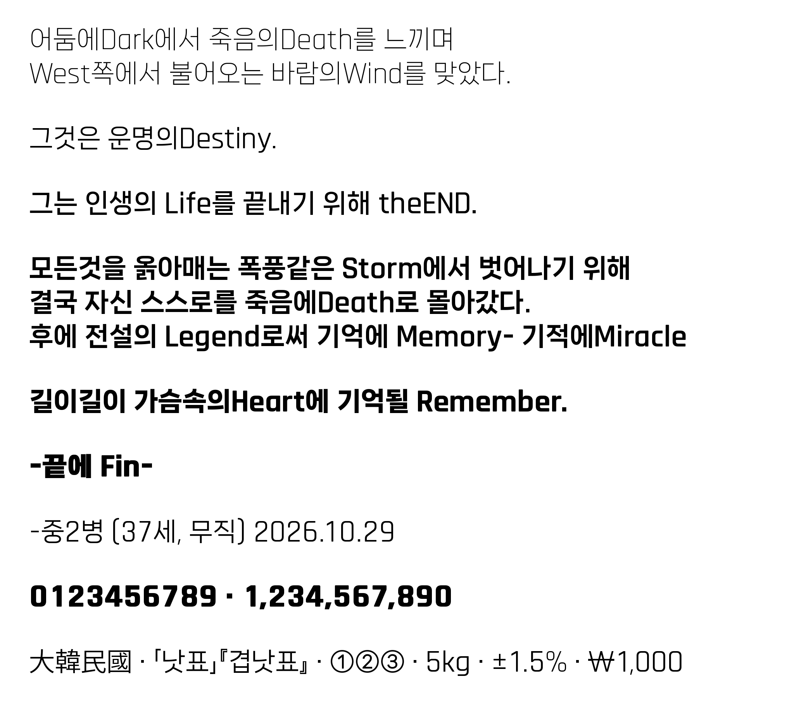

# 브루탈믹스 (BrutalMix) 폰트

## [즉시 다운로드](https://github.com/galaon/BrutalMix/releases/latest/download/BrutalMix.zip)

항상 [최신 릴리스](https://github.com/galaon/BrutalMix/releases/latest)의 `BrutalMix.zip`이 받아집니다. (현재 v1.7.3)

내가 쓰고싶어서 AI 시켜서 만든 밤티나는(중요) 폰트입니다. 
이것저것 되는대로 '무자비하게 뒤섞어놔서' 브루탈믹스 입니다.

한글 : [나눔스퀘어 네오](https://hangeul.naver.com/font) / 영문 : [Rajdhani](https://fonts.google.com/specimen/Rajdhani) (일부 글자만 [Cairo](https://fonts.google.com/specimen/Cairo)) / 문장부호 : [Spoqa 한 산스 네오](https://spoqa.github.io/spoqa-han-sans/) / 한자·그리스·키릴·가나 : [Noto Sans KR](https://fonts.google.com/noto/specimen/Noto+Sans+KR)

원 폰트의 저작권은 원 저작자에게 있습니다. 
변경 및 가공 라이센스를 제공해주신 원 저작자 분들에게 감사의 말씀을 드립니다.

| 번호 | 웨이트 | 파일 |
|---|---|---|
| 01 | Light | `BrutalMix_01_Light.ttf` |
| 02 | Regular | `BrutalMix_02_Regular.ttf` |
| 03 | Bold | `BrutalMix_03_Bold.ttf` |
| 04 | ExtraBold | `BrutalMix_04_ExtraBold.ttf` |
| 05 | Heavy | `BrutalMix_05_Heavy.ttf` |
| 06 | Black | `BrutalMix_06_Black.ttf` |

**설치 방법**
1. 이전 버전을 설치했다면 먼저 지웁니다. Windows **설정 → 개인 설정 → 글꼴**에서 "Brutal"로 검색해 나오는 항목을 모두 제거합니다.
2. TTF 파일 6개를 설치합니다.
3. 사용하던 프로그램을 다시 실행합니다. (웹 Figma는 Figma Agent도 다시 실행)

웹에서 쓸 때는 다운로드한 zip 안 `web` 폴더의 WOFF2 파일과 `brutalmix.css`를 사용하면 됩니다.

**프로그램에서 보이는 이름**
- 6개 웨이트가 하나의 패밀리로 묶여 있습니다. 패밀리를 고른 뒤 `01 Light` ~ `06 Black` 중에서 웨이트를 선택합니다.
- 한국어 환경: `BrutalMix 브루탈믹스` (예: After Effects 등)
- 영문 환경·Figma: `BrutalMix` (Figma는 영문 이름만 읽기 때문에 영문 이름에는 한글을 넣지 않았습니다)

**숫자 조판 팁**
- 숫자는 고정폭입니다. 숫자끼리는 커닝 없이 항상 같은 폭으로 줄이 맞습니다.
- 수식 기호 `+` `−` `±` `=` `×` `÷` `<` `>` `≤` `≥` `≠` `≈` 도 숫자와 같은 폭이라, 부호가 붙은 숫자(`+3.2` `−3.2`)도 줄이 맞습니다.
- 기본 상태에서는 숫자와 소수점·쉼표·콜론 사이(예: `3.14`의 `.1`)에만 커닝이 들어가 있어, 문장 속 숫자가 자연스럽게 보입니다.
  이 때문에 같은 자릿수라도 숫자에 따라 전체 폭이 최대 약 0.2~0.3em, 소수점 위치가 약 0.08em 달라질 수 있습니다.
- **표처럼 자릿수·소수점을 세로로 정확히 맞춰야 할 때는 고정폭 숫자(OpenType `tnum`, Tabular figures) 기능을 켜세요.**
  위 커닝이 빠져, 형식이 같은 숫자(`1,388.50` / `917.14` 등)는 폭과 소수점 위치가 정확히 같아집니다.
  - Figma: 오른쪽 패널 Text 영역의 Type settings → Details → Numbers에서 고정폭(Tabular / Monospace) 선택
  - OpenType 기능을 켤 수 없는 프로그램에서는 해당 텍스트의 커닝(자동 커닝) 값을 0으로 두면 같은 효과입니다.
- 표에서 소수점 이하만 70~80% 크기로 줄이면 소수점 기준 정렬이 더 또렷하게 보입니다.

## 제작 방식

이 폰트는 아래 5종의 오픈 폰트를 **글리프 단위로 병합**하여 만든 파생 폰트입니다.

- **한글, 한글 조판 기호(원문자·도형·화살표·묶음표 등)** — 나눔스퀘어 네오 (NanumSquare Neo)
- **라틴 알파벳·숫자·괄호·수식 기호 등** — Rajdhani
- **K, k (이 두 글자만)** — Cairo
- **문장부호(쉼표·마침표·따옴표·가운데점·말줄임표 등)** — Spoqa 한 산스 네오
- **한자(1,816자)·그리스 문자·키릴 문자·히라가나·가타카나** — Noto Sans KR (대한민국 표준 한국 자형)

단위 기호(`㎏` `㎡` 등)와 로마 숫자(`Ⅰ` `ⅰ` 등)는 이 폰트의 영문 글자를 이어 붙여 만들었습니다.

각 폰트의 정렬 기준(베이스라인·글자 높이)이 서로 달라, 나눔스퀘어 네오가
자신의 라틴·부호를 배치한 위치를 기준으로 나머지 폰트를 맞춰 정렬했습니다.
Black 웨이트는 Heavy를 세로획 위주로 굵혀 합성한 웨이트입니다.

글자 크기·기준선·줄높이는 [Pretendard](https://github.com/orioncactus/pretendard)와 같게 맞춰,
같은 크기로 섞어 써도 한글 높이와 줄 위치가 일치합니다.

## 버전 기록

**v1.7.3** (2026-10-29) — 한자·외국 문자 추가, 특수문자·숫자 정리
- 한자 1,816자 추가: 한문 교육용 기초한자 1,800자 + 뉴스 보충 7자 + 완성형 이체 코드 9자(`强` `産` `絶` 등).
  대한민국 표준인 한국 자형(Noto Sans KR)이며, 굵기마다 한글 획 두께에 맞췄습니다.
- 완성형(KS X 1001) 기호를 모두 갖춤: `～` `〈 〉` 추가, 그리스 문자·키릴 문자·히라가나·가타카나 추가
- 서유럽·중유럽 악센트 문자(Latin-1, Latin Extended-A) 추가, `≈` `π` `Ω` `∆` `◊` 추가
- 숫자 OpenType 기능 추가: 비례폭 숫자(`pnum`), 표 정렬용 고정폭(`tnum`), 사선 0(`zero`), 위·아래 첨자(`sups` `subs` `sinf`), 분수(`frac`)
- 스타일 세트 추가: `ss01`(세리프 I, 꼬리 l, 사선 0), `ss02`(Rajdhani 모양 K·k)
- 수식 기호 `+ − × ÷ = ± ≠ < > ≤ ≥ ¬ ≈`의 폭을 숫자 폭과 같게 통일하고, `± ≤ ≥ ≠`를 같은 모양으로 다시 만듦
- 말줄임표(…)를 Spoqa 원래 비율로 줄임 (폭 1.40em → 0.89em)
- `‹ › « »`를 Rajdhani 모양으로, `ñ` `ã` `õ` 등의 물결 악센트를 부드러운 물결로 교체
- 묶음표(`「」『』《》【】〔〕〈〉`)를 전각에서 글자에 맞춘 폭으로 바꾸고, 낫표·겹낫표 크기를 Pretendard 비율로 조정
- 단위 기호 80자와 로마 숫자 20자를 영문 글자 조합으로 다시 만듦 (`5㎏`과 `5kg`이 같게 보임)
- 원문자·괄호문자(`①` `㉠` `⑴` 등) 획을 본문 굵기에 가깝게 보강 (Regular~Heavy)
- Bold·ExtraBold 영문 획 보강, `▲` `▼` 폭 축소
- 묶음표·단위 기호·로마 숫자·말줄임표의 폭이 바뀌어, 이 글자가 들어간 기존 문서는 줄 길이가 달라질 수 있습니다.
- 이전 버전을 설치했다면 먼저 지우고 설치하세요.

**v1.3.1** (2026-10-28) — 숫자·숫자 기호 정렬 보정 (글자 모양은 그대로)
- 고정폭 숫자 `1`이 칸 오른쪽으로 치우쳐 보이던 것을 Pretendard 고정폭 `1` 수준으로 이동
- 마침표 앞뒤 여백을 같게 맞춤 (`3.14`에서 마침표가 앞 숫자에 붙어 보이던 문제)
- `€` `#` `₩` `–` 과 괄호 안쪽 여백을 줄여 숫자와의 간격을 고르게 맞춤
- `−` `×` 와 숫자 사이 간격을 `+` 와 같게, `℃` 앞 간격을 `°` 와 같게 맞춤
- 숫자와 소수점·쉼표·콜론 사이 커닝 예외 추가 (`.1` `1.` `7.` `.4` 등, 숫자끼리는 고정폭 유지)
- 이전 버전을 설치했다면 먼저 지우고 설치하세요.

**v1.2.2** (2026-10-19) — 폰트 이름만 변경, 글자 모양·간격은 v1.1과 동일
- 6개 웨이트를 하나의 패밀리(`BrutalMix 브루탈믹스`)로 묶고 웨이트를 `01 Light` ~ `06 Black` 스타일로 분리 (Figma·Adobe 웨이트 선택 지원)
- Figma에서 이름이 `?????`로 깨지던 문제 수정 — 영문 이름은 `BrutalMix`, 한글 이름은 `BrutalMix 브루탈믹스`
- 이전 버전을 설치했다면 먼저 지우고 설치하세요.

**v1.1** (2026-10-03)
- 글자 크기·기준선·줄높이를 Pretendard에 맞춤 (v1.0보다 글자가 5~7% 작아짐)
- 영문 x높이를 대문자의 76%로 조정, 영문 좌우 여백 정리, 영문 커닝 추가
- 숫자 고정폭 복구 (원본에서 딸려온 커닝 제거)
- Black 웨이트 다시 제작, 띄어쓰기 폭 확대
- 말줄임표(…)는 Spoqa, 글머리점(•)은 Cairo로 교체, 왼쪽 이중 화살표(⇐) 추가
- 폰트 메뉴 이름을 한글·영문 검색 모두 `브루탈믹스 BrutalMix 01 Light` 형식으로 통일
- v1.0을 설치했다면 먼저 지우고 설치하세요.

**v1.0** (2026-09-02) — 첫 공개

## 라이선스

이 파생 폰트(BrutalMix)는 **SIL Open Font License 1.1** 로 배포됩니다. → [`OFL.txt`](OFL.txt)

사용한 원본 폰트의 저작권자와 라이선스는 [`licenses/THIRD-PARTY-NOTICES.md`](licenses/THIRD-PARTY-NOTICES.md)
에 정리되어 있습니다. 요약하면:

- 5종 모두 자유로운 **사용·수정·병합·재배포**가 가능합니다.
- **폰트 파일 자체를 유료로 판매하는 것은 금지**됩니다. (무료 배포는 허용)
- 파생물도 **같은 오픈 라이선스**로만 배포할 수 있습니다.
- 원본 이름(NanumSquare/Nanum, Rajdhani, Spoqa, Cairo, Noto, Source)은 이 폰트 이름에
  사용하지 않았습니다. "브루탈믹스 / BrutalMix"는 독립된 이름입니다.

> **저작권 및 상표 주의**
> - "NanumSquare Neo"는 (주)네이버의 **등록상표**입니다. 이 이름을 파생 폰트 이름에
>   쓸 수 없으며, 본 폰트는 사용하지 않습니다.
> - 원저작자들이 이 파생물을 보증·승인한 것은 아닙니다. 본 저장소는 원본을
>   병합했다는 **사실을 출처로 밝히는 것**이며, 원저작자의 추천을 의미하지 않습니다.

## 사용한 원본 (출처)

- 나눔스퀘어 네오 — © 2022 NAVER Corp., 제작 Sandoll Inc. — https://hangeul.naver.com/font
- Rajdhani — © 2014 Indian Type Foundry — Google Fonts (OFL) — https://fonts.google.com/specimen/Rajdhani
- Spoqa 한 산스 네오 — © 2020 Spoqa — https://spoqa.github.io/spoqa-han-sans/
- Cairo — © 2009 The Cairo Project Authors — Google Fonts (OFL) — https://fonts.google.com/specimen/Cairo
- Noto Sans KR — © 2014-2021 Adobe, 예약 폰트 이름 'Source' — Google Fonts (OFL) — https://fonts.google.com/noto/specimen/Noto+Sans+KR

## 면책

이 저장소의 라이선스 정리는 참고용이며 법적 자문이 아닙니다. 배포 전 각 원본
폰트의 **공식 배포처 라이선스 원문**(특히 예약 폰트 이름 지정 여부)을 직접
확인하시기 바랍니다.
